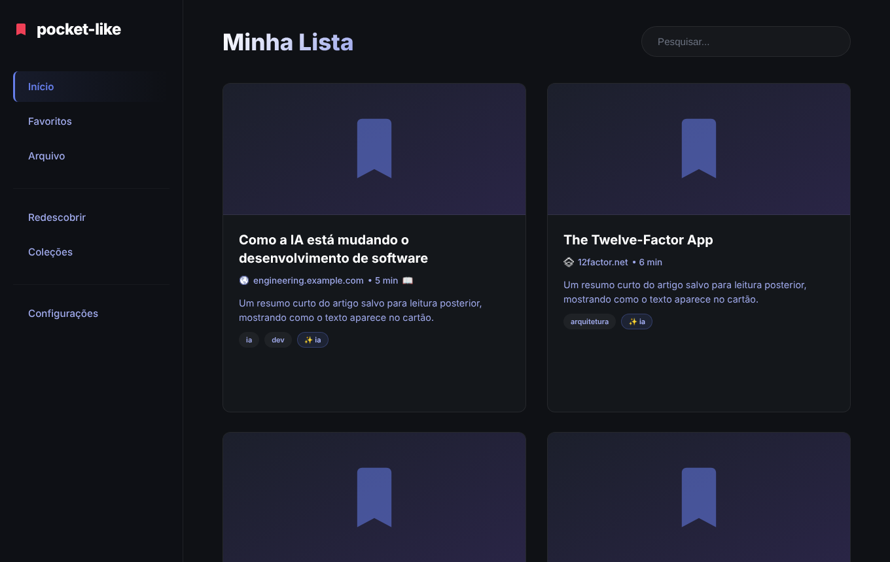
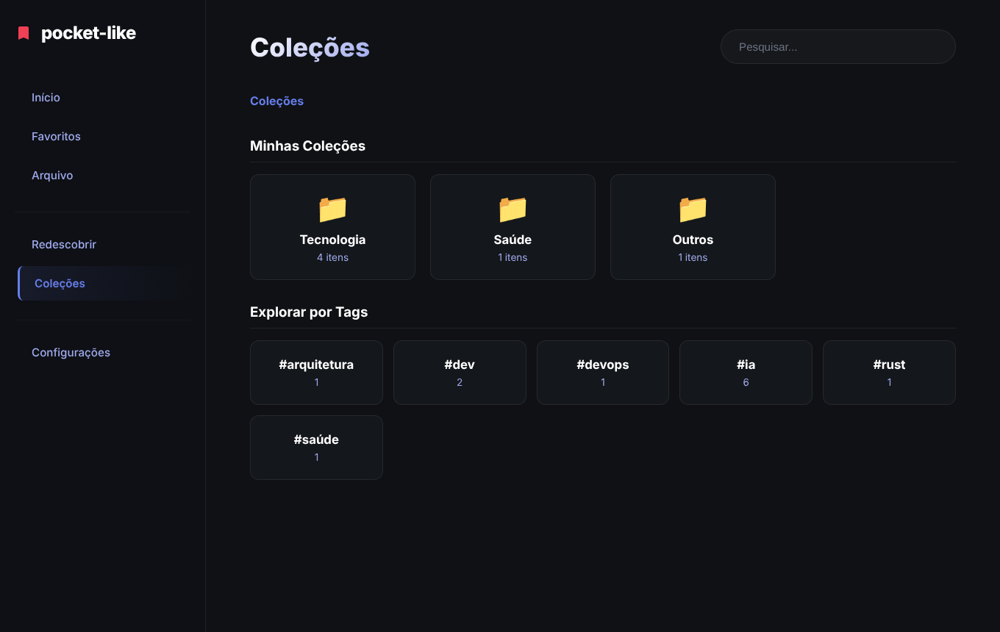
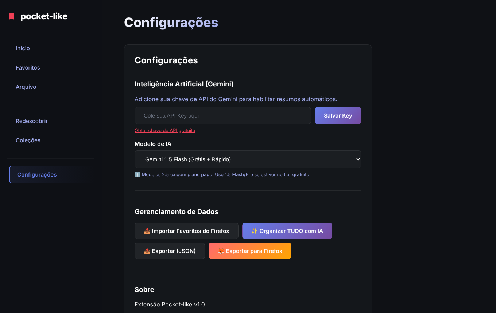
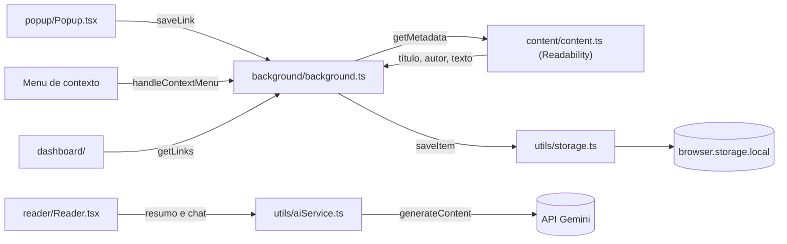

<div align="center">

# Pocket-like

**Extensão para Firefox no estilo do Pocket: salve links, leia sem distrações e organize a biblioteca com IA.**<br/>
Os dados ficam só no navegador (`browser.storage.local`), sem conta e sem servidor.


[Funcionalidades](#funcionalidades) · [Como funciona](#como-funciona) · [Começando](#começando) · [Segurança](#segurança) · [Limitações](#limitações-conhecidas) · [Contribuindo](#contribuindo)

<br/>



</div>

## Funcionalidades

- **Salvar**: botão da extensão, menu de contexto ou atalho `Ctrl+Shift+S`.
- **Metadados automáticos**: título, descrição, imagem, autor e tempo de leitura.
- **Leitor imersivo**: texto limpo (Readability), temas claro/sépia/escuro, barra de progresso e leitura em voz alta (TTS).
- **IA com Gemini** (opcional): resumo, conceitos-chave, chat com o artigo e organização automática em pastas e tags, com prévia antes de aplicar.
- **Dashboard**: Início, Favoritos, Arquivo, Redescobrir (item aleatório não lido) e Coleções (pastas hierárquicas e tags).
- **Importar e exportar**: favoritos do Firefox, JSON e exportação de volta para o Firefox.
- **Privacidade**: sem conta e sem servidor. A chave do Gemini fica só no seu navegador.

| Coleções | Configurações |
|---|---|
|  |  |

## Como funciona



- O texto completo fica em uma chave separada (`content_<id>`); a lista de itens guarda só metadados (`utils/storage.ts`).
- O tempo de leitura é estimado a 200 palavras por minuto (`calculateReadTime`).
- A importação de favoritos do Firefox é feita em lotes de 100 (`background/background.ts`).

## Começando

Requisitos: Node 20+ e pnpm (ou npm).

```bash
cd firefox-pocket-extension
pnpm install
pnpm run build:prod
```

Para carregar no Firefox, abra `about:debugging` → *Este Firefox* → *Carregar extensão temporária…* e escolha `dist/manifest.json`.

> [!WARNING]
> Extensão carregada por *Carregar extensão temporária…* é removida quando o Firefox fecha. Carregue de novo a cada sessão.

Para rodar em um perfil de desenvolvimento: `pnpm run start:firefox`.

### Configurar a IA

1. Gere uma chave gratuita no [Google AI Studio](https://aistudio.google.com/app/apikey).
2. Na extensão, abra **Configurações**, cole a chave e escolha o modelo.

## Scripts

| Comando | O que faz |
|---|---|
| `pnpm run build` / `build:prod` | Compila para `dist/` |
| `pnpm run watch` | Recompila ao salvar |
| `pnpm test` | Jest com cobertura |
| `pnpm run package` | Gera o `.zip` em `web-ext-artifacts/` |
| `pnpm run start:firefox` | Abre o Firefox com a extensão |

## Estrutura

```text
firefox-pocket-extension/
├── manifest.json
└── src/
    ├── background/   salvar links, importar/exportar, organização com IA
    ├── content/      extração de conteúdo da página
    ├── popup/        popup da extensão
    ├── dashboard/    gerenciamento (views, hooks e modais)
    ├── reader/       leitor, TTS e chat com IA
    ├── components/   ItemCard, Modal, TTSPlayer, ...
    ├── utils/        storage, aiService, aiOrganizer, folderStructure
    └── styles/       tema compartilhado (glassmorphism)
```

## Contribuindo

Veja [CONTRIBUTING.md](CONTRIBUTING.md) e [AGENTS.md](AGENTS.md). Regras principais: **máx. 150 linhas por arquivo**, testes passando, e nenhum dado sensível no contexto. O roteiro está em [ROADMAP.md](ROADMAP.md).

## Segurança

| Camada | Proteção |
|---|---|
| Armazenamento | itens, conteúdo e chave do Gemini ficam em `browser.storage.local`; a extensão não aplica criptografia própria |
| Rede | a API do Gemini (`generativelanguage.googleapis.com`) recebe dados só nas ações de IA, e a chave vai como parâmetro `key` na URL dessa chamada. Favicons são buscados em `www.google.com/s2/favicons` |
| Conteúdo | o HTML salvo passa por DOMPurify antes de ser exibido no leitor e no chat |
| Permissões | o content script roda em todas as páginas (`<all_urls>`) para extrair o texto do artigo |

## Limitações conhecidas

- **Só Firefox**: o manifesto declara `strict_min_version` 109.0 e não há build para outros navegadores.
- **Sem sincronização**: os dados ficam no perfil em que foram salvos. Use a exportação em JSON para levar a biblioteca a outro lugar.
- **IA opcional**: resumo, chat e organização exigem sua chave do Gemini e conexão. Sem chave, as funções sem IA continuam funcionando.
- **Leitura limpa depende da página**: quando o Readability não reconhece um artigo, o texto salvo pode faltar.
- **Tempo de leitura é estimativa**: calculado a partir do texto extraído, não medido.

## Stack

React 19, TypeScript, Webpack 5, Framer Motion, `@mozilla/readability`, DOMPurify, `webextension-polyfill` e Google Gemini API.

## Licença

ISC, conforme o campo `license` de `firefox-pocket-extension/package.json`. O repositório ainda não tem arquivo `LICENSE`.
