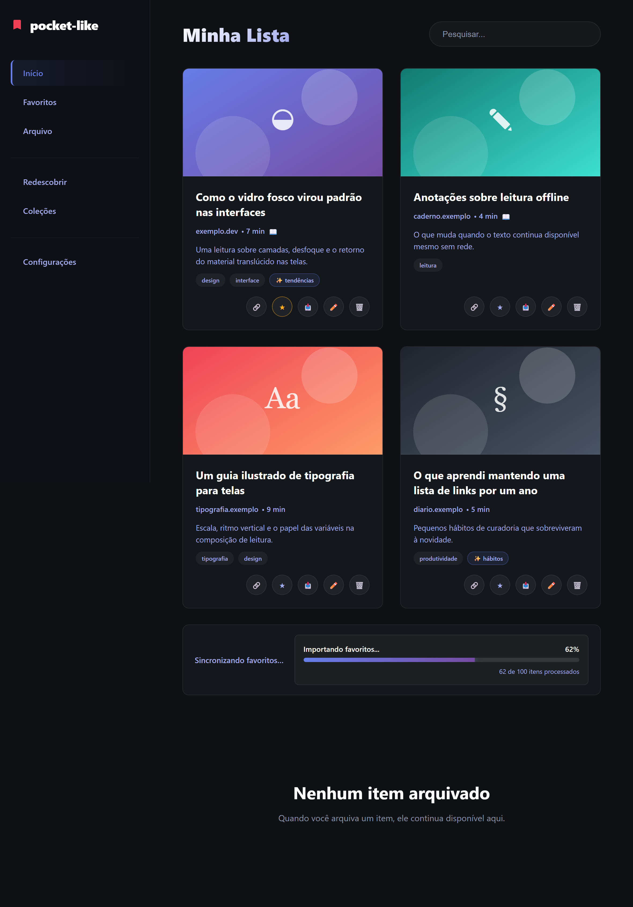
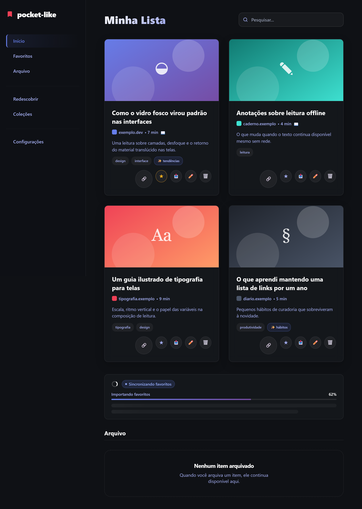

# Sonido 2.5 migration — Firefox Pocket extension

Pocket's extension UI now renders on [`@juninmd/sonido@2.5.0`](https://www.npmjs.com/package/@juninmd/sonido).
The app keeps its own glassmorphism identity: Sonido's `--sn-*` tokens are bridged to
Pocket's palette and the `#667eea` accent in `src/styles/sonido.css`.

No legacy folder was created: the old primitives were replaced in place.

## Before / after

| Antes (`origin/master`) | Depois (this branch) |
| --- | --- |
|  |  |

Both screenshots were captured with the same fictitious article list, viewport
1180×900 at 2× (`fullPage`). The "antes" page is an ephemeral harness using the old
markup with the real `src/dashboard/index.css`; the "depois" page is an ephemeral
React harness rendering the migrated components. Neither harness is committed.
No real browsing data or external images were used — covers are inline SVG data URIs.

## Components swapped

| Sonido primitive | Where it replaced the old UI | Files |
| --- | --- | --- |
| `Button` | Primary/secondary/ghost/icon buttons, nav rows, dialog footers, import/export actions | `components/ItemCard.tsx`, `dashboard/Sidebar.tsx`, `dashboard/CollectionsView.tsx`, `dashboard/DiscoverView.tsx`, `dashboard/SettingsView.tsx`, `dashboard/DataManagement.tsx`, `dashboard/FolderNav.tsx`, `dashboard/useModal.tsx`, `dashboard/EditItemModal.tsx`, `popup/Popup.tsx`, `reader/Reader.tsx` |
| `Card` | Item cards, discover card, collection tiles, settings panel | `components/ItemCard.tsx`, `dashboard/DiscoverView.tsx`, `dashboard/CollectionsView.tsx`, `dashboard/SettingsView.tsx` |
| `Badge` | File tags, AI tags, tag counters, popup tags | `components/ItemCard.tsx`, `dashboard/CollectionsView.tsx`, `dashboard/OrganizePreview.tsx`, `dashboard/EditItemModal.tsx`, `popup/Popup.tsx` |
| `Dialog` | Modal, on the native `<dialog>` element (focus trap, Esc, backdrop) | `components/Modal.tsx` (public `Modal` API preserved) |
| `EmptyState` | Empty list/search, empty tag, empty folder, archive empty, discover empty | `dashboard/Dashboard.tsx`, `dashboard/CollectionsView.tsx`, `dashboard/DiscoverView.tsx` |
| `Skeleton` | Dashboard first load and popup loading state | `dashboard/Dashboard.tsx`, `popup/Popup.tsx`, `dashboard/useItems.ts` (`loading`) |
| `Spinner` | Popup loading/saving | `popup/Popup.tsx` |
| `SearchField` | Dashboard search | `dashboard/Dashboard.tsx` |
| `TextField` | Gemini key field, item folder/tags, popup tag input | `dashboard/SettingsView.tsx`, `dashboard/EditItemModal.tsx`, `popup/Popup.tsx` |
| `Select` | Gemini model picker | `dashboard/SettingsView.tsx` |
| `Tabs` | Reader AI sidebar (Chat / Conceitos) | `reader/Reader.tsx` |
| `Toast` / `ToastProvider` | Confirmation after saving the API key | `dashboard/Dashboard.tsx`, `dashboard/SettingsView.tsx` |
| `ProgressBar` | Import progress and reader scroll progress | `dashboard/DataManagement.tsx`, `components/ReadingProgressBar.tsx` |

`data-theme="glass"` is applied to `<html>` by `src/styles/sonido.ts`, which also
imports `@juninmd/sonido/styles.css` once per bundle (dashboard, popup, reader).

## Kept local (no Sonido equivalent)

- **Reader typography** (`reader/index.css`, article themes light/dark/sepia, font size/family).
  Sonido has no reader surface/typography component.
- **`Mascot`** (`popup/Mascot.tsx`) — Pocket's own character, Framer Motion animation.
- **`TTSPlayer`** (`components/TTSPlayer.tsx`) — browser-native speech synthesis.
- **Popup shell** (`popup/index.css`) — 350px toolbar panel layout.
- **Qr** — not used anywhere in this app, so nothing to keep or migrate.
- `Artwork`, `Avatar`, `Menu`, `Tooltip`, `Kbd`, `ConfirmButton`, `PageHeader` exist in
  Sonido but Pocket has no matching generic primitive in this codebase (favicons are
  inline ``, nav is a sidebar, dialogs are two-step by explicit footer buttons),
  so none were introduced just to pad the migration.

## Commands and results

Run inside `firefox-pocket-extension/`.

| Command | Result |
| --- | --- |
| `pnpm install --frozen-lockfile` | pass (1 lockfile: `pnpm-lock.yaml`) |
| `pnpm exec tsc -p tsconfig.build.json --noEmit` | pass |
| `pnpm exec jest --ci` | pass — 24 suites, 293 tests (was 291 passed + 1 skipped on `master`) |
| `pnpm run build:prod` | pass — 3 pre-existing asset-size warnings |

`pnpm exec tsc --noEmit` (whole repo, including tests) is not a supported gate on
`master` either: it reports pre-existing missing `@types/node`/jest-dom typings and
test-only `global`/union errors. The build/CI typecheck is `tsconfig.build.json`.

There is no lint script in this package (`AGENTS.md` says so); CI only runs Jest and
`build:prod`.

Windows baseline: the same commands were run on a detached `origin/master` worktree
(`before-pocket`) with the same Node/pnpm on Windows. Two full runs: the first hit a
one-off timing flake in `ChatPanel › should handle errors`, which passed in isolation
and on the second full run (`24 suites, 291 passed, 1 skipped`); `build:prod` also
passes. No deterministic Windows-only failure exists before or after the migration,
so there was nothing to quarantine.

## Test changes (none skipped)

- `Modal` now renders Sonido's `<dialog>`: tests assert the native `open` state,
  close button, `cancel` (Escape) event and danger/success modifiers. `jest.setup.ts`
  shims `showModal`/`close`, which jsdom 20 does not implement.
- Focus-trap unit tests were removed because the native `<dialog>` owns the trap;
  the accessibility test now checks the dialog's `aria-labelledby`/title instead of
  the old hardcoded `modal-title` id and explicit `aria-modal`.
- `ReadingProgressBar` tests cover the accessible `progressbar` value at 0/50/100%.
- The one pre-existing `it.skip` (API key save timeout) was enabled and passes.
- Button label spans mean `toBeDisabled` is asserted on the button role, not the
  label text node.

## Caveats

- `@juninmd/sonido` publishes ESM only, so `jest.config.js` lets `ts-jest` transpile
  that one dependency to CommonJS. The app bundle is unchanged by this.
- Sonido's `Dialog` always renders its content; `Modal` mounts it only while open to
  keep Pocket's previous "not in the DOM when closed" behaviour and its tests.
- Bundle size warnings (popup/dashboard/reader > 244 KiB) pre-exist and grew slightly
  with the design system CSS; no performance budget exists in CI.
- The dependency is pinned to the published `^2.5.0`; the local `sonido` checkout was
  not used or cloned.
